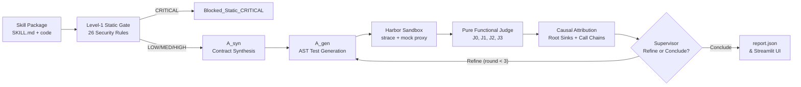

# Agent Skill Verification & Security Pipeline

A hybrid static-dynamic verification system for detecting intent-behavior divergence and unauthorized actions in AI agent skills (`SKILL.md` specifications versus executable Python/Bash scripts). The pipeline evaluates declarative permissions, synthesizes Hoare-style behavioral contracts, generates dynamic test fixtures, executes skills inside network-isolated Harbor Docker containers instrumented with `strace` and Python audit hooks, performs pure functional adjudication, and maps detected violations to exact specification lines and source code sites. Primary outputs include structured evaluation reports (`report.json`), full container execution traces, and an interactive Streamlit inspection dashboard.

---

## 1. Pipeline Overview

The verification pipeline executes in two primary stages:

1. **Level-1 Static Gate**: Inspects skill declarations and script ASTs across 26 security rules (`src/security/level1_scanner.py`). Skills flagged with `CRITICAL` risk (e.g. reverse shells, raw C2 IPs, composite file-read-to-network flows) are blocked immediately (`Blocked_Static_CRITICAL`) without container dispatch. Passing skills (`LOW`, `MEDIUM`, `HIGH`) enter Level-2.
2. **Level-2 Dynamic Verification**:
   - **Contract Synthesizer ($A_{\text{syn}}$)**: Reads `SKILL.md` only (enforced by `runtime_bias_guard`) to synthesize behavioral contracts $\langle P, Q, F, I \rangle$ with multi-chunking and schema validation (`agent_skills/a_syn`).
   - **Test Generator ($A_{\text{gen}}$)**: Extracts CLI and AST argument structures to synthesize test fixtures exercising declared commands and subcommands (`agent_skills/a_gen`).
   - **Execution Engine ($A_{\text{exec}}$)**: Scaffolds Harbor tasks and executes skills inside Docker containers (`harbor-base:latest`) instrumented with `strace -f`, `sys.addaudithook` (`src/callsite_hook.py`), and a local HTTP mock proxy (`127.0.0.1:8080`). Script skills are strictly restricted to localhost networking.
   - **Pure Functional Judge ($A_{\text{adj}}$)**: Evaluates observed `BehaviorUnit`s against contracts and security invariants through J0 (RunHealth), J1 (Violations), J2 (Contracts), and J3 (Verdicts), producing canonical verdicts and splitting Dynamic Test Coverage (DTC) and Contract Satisfaction Rate (CSR-c).
   - **Causal Attribution**: Matches violations to root sink code sites and call chains in Python source code and links undeclared actions to `SKILL.md` lines.
   - **Orchestration Supervisor ($A_{\text{orch}}$)**: Coordinates refinement loops (up to 3 rounds) to boost coverage or resolve harness usage errors before emitting final verdicts.



---

## 2. Installation and Setup

### 2.1 Prerequisites
- Python 3.11+
- Docker Engine / Docker Desktop (Linux containers enabled)
- Harbor CLI (`harbor` available in PATH)

### 2.2 Environment Setup
1. Clone the repository and create a Python virtual environment:
   ```powershell
   python -m venv venv
   .\venv\Scripts\Activate.ps1
   pip install -r requirements.txt
   ```
2. Build the base container image:
   ```powershell
   docker build -f docker/Dockerfile.base -t harbor-base:latest docker/
   ```
3. Configure environment secrets:
   Copy `.env.example` to `.env` and configure credentials:
   ```powershell
   Copy-Item .env.example .env
   ```
   Add your OpenAI API key or Gemini API key if enabling LLM-assisted generation:
   ```text
   OPENAI_API_KEY=your_openai_api_key_here
   GEMINI_API_KEY=your_gemini_api_key_here
   ```

---

## 3. How to Run

### 3.1 Interactive Streamlit Dashboard
Launch the web interface for single-skill inspection, live batch monitoring, and dataset sampling:
```powershell
streamlit run streamlit_app.py
```

### 3.2 Batch Pipeline Runner
Execute dynamic verification across a manifest of skills using the wave-parallel batch engine:
```powershell
python src/pipeline_runner.py --manifest path/to/manifest.json --batch --concurrency 4
```
To resume an interrupted run:
```powershell
python src/pipeline_runner.py --manifest path/to/manifest.json --batch --resume
```

### 3.3 Single-Skill LangGraph Execution
Run a single skill through the LangGraph StateGraph pipeline:
```powershell
python graph.py --skill path/to/skill_directory
```

### 3.4 Diagnostic CLI
Run quick end-to-end diagnostics on a skill package:
```powershell
python diagnose.py --skill path/to/skill_directory
```

### 3.5 Preflight Calibration Controls
Verify system harness integrity, instrumentation, and invariant enforcement (Controls C1–C11):
```powershell
python run_controls_check.py
```

---

## 4. Environment Variables Reference

| Variable | Default | Purpose | Key Present vs Absent |
| :--- | :--- | :--- | :--- |
| `OPENAI_API_KEY` | `""` | OpenAI API access | Enables LLM generation; falls back to deterministic if missing. |
| `GEMINI_API_KEY` | `""` | Google Gemini API access | Provider fallback for Gemini models. |
| `ANTHROPIC_API_KEY` | `""` | Anthropic API key | Passed to container env only for instruction-only runs (`claude-code`). |
| `USE_LLM_AGEN` | `"1"` | Enable LLM test fixture generator | If `"0"` or key missing, uses AST/CLI schema test generator. |
| `AGEN_MODEL` | `gpt-4o-mini`| LLM model for test generation | Evaluated at temperature 0.0. |
| `USE_LLM_AORCH` | `"1"` | Enable LLM tool-calling supervisor | If `"0"` or key missing, uses deterministic state policy. |
| `AORCH_MODEL` | `gpt-4o-mini`| LLM model for supervisor decisions | Bypassed when state invariants force finalization (`policy_forced`). |
| `USE_LLM_POSTCONDITION`| `"1"`| Enable J2 semantic postcondition judge| If `"0"` or key missing, returns `INDETERMINATE`. |
| `USE_LLM_EXPLAINER` | `"1"` | Enable grounded explanation narrative | If `"0"` or key missing, uses template finding summary. |
| `AADJ_MODEL` | `gpt-4o-mini`| LLM model for postconditions & explainer| Evaluated at temperature 0.0. |
| `ASYN_MODEL` | `gpt-4o-mini`| LLM model for contract synthesis | Reads documentation only; falls back to cached contracts. |
| `ASYN_MAX_CHUNKS` | `12` | Max chunks for large `SKILL.md` documents| Caps chunk processing; scans skipped lines deterministically. |
| `ALIGNED_MIN_DTC` | `0.8` | Minimum DTC threshold for `Aligned` | Requires $\text{dtc} \ge 0.8$ alongside 0 violations/divergences. |
| `MAX_REFINEMENT_ATTEMPTS`| `3` | Maximum refinement iterations | Halts refinement loop when round limit is reached. |
| `USE_HARBOR_BATCH` | `"1"` | Enable wave-parallel Harbor execution | If `"0"`, runs sequential container trials. |
| `HARBOR_WAVE_CHUNK_SIZE` | `5` | Wave batch chunk size | Controls number of skills batched per wave. |
| `HARBOR_BATCH_CONCURRENCY`| `4` | Concurrency worker thread count | Controls parallel Harbor CLI worker processes. |

---

## 5. Agent Skills Directory & Versioning

LLM agents operate through standardized packages located under `agent_skills/`:
- `agent_skills/a_syn/`: Contract synthesis and Level-1 security invariants (`version: 1.1.0`).
- `agent_skills/a_gen/`: Dynamic test fixture and AST-grounded test generation (`version: 1.0.0`).
- `agent_skills/a_orch/`: Orchestration supervisor tool-calling and directive loop (`version: 1.0.0`).
- `agent_skills/a_adj/`: Adjudication contract schema and postcondition evaluation (`version: 1.0.0`).
- `agent_skills/a_adj_explainer/`: Grounded natural language finding explanation (`version: 1.0.0`).
- `agent_skills/a_adj_j2/`: J2 semantic postcondition judge and anti-hallucination rules (`version: 1.1.0`).

Each agent directory contains:
- `SKILL.md`: Frontmatter defining role, inputs, outputs, boundaries, and prompt body.
- `schemas/output.schema.json`: Strict JSON schema enforced on all LLM responses.
- **SHA-256 Versioning**: `src/agent_skill_loader.py:get_agent_skill_version_hash` computes a SHA-256 hash over the package body and schema, embedding the hash in every `agent_messages` telemetry record and caching key.

---

## 6. Output Files and Artifacts

### 6.1 `report.json`
Every pipeline run generates an atomic `report.json` containing:
- **Run-Level Summary**: `run_id`, `total_skills`, `completed_skills`, `verdict_distribution`, `run_status_distribution`, `average_dtc`, `average_csr_c`, `contracts_total`, `contracts_testable`, `contracts_non_testable`, `attribution_coverage`, and `agent_execution_summary`.
- **Per-Skill Records**: Canonical `verdict`, `no_verdict_reason`, `level1_risk`, `dtc`, `csr_c`, synthesized `contracts`, observed `violations`, causal `attributions` (root sink and call chain), grounded `explanation`, and `agent_messages` timeline.

### 6.2 Trial Execution Artifacts
Harbor task execution produces the following raw evidence files under task directories:
- `strace.log`: Full system call trace capturing file operations, network connections, and process executions.
- `callsites.jsonl`: Python audit events recorded via `sys.addaudithook`.
- `executed_functions.json`: Python function profile.
- `mock_egress.jsonl`: Intercepted HTTP/HTTPS requests with method, host, path, and headers.
- `run_status.json`: Execution metadata including exit code and environment variables.
- `fs_diff`: Filesystem modifications relative to base container image.

---

## 7. Canonical Verdicts and Inconclusive Reasons

### 7.1 Canonical Verdicts (Priority Order)
1. **`Undeclared_Behavior`**: Emitted when one or more runtime security violations occur (e.g. undeclared file writes, forbidden path access, network connections to undeclared hosts, or canary exfiltration). Wins over all other verdicts.
2. **`Inconclusive(NO_TESTABLE_CONTRACTS)`**: Emitted when all synthesized contracts are marked `testable=False`, preventing empirical test measurement.
3. **`Semantically_Divergent`**: Emitted when code executes successfully without security violations, but observed evidence contradicts declared postconditions.
4. **`Unimplemented_Intent`**: Emitted when execution reaches an AST stub / `NotImplementedError`, or when execution exits 0 with valid inputs but produces zero observable effect (`EFFECT_ABSENT`).
5. **`Aligned`**: Emitted when at least 1 contract passes, 0 contracts are contradicted, 0 are unimplemented, 0 security violations exist, and $\text{dtc} \ge \text{ALIGNED\_MIN\_DTC}$ (default 0.8).
6. **`Blocked_Static_CRITICAL`**: Emitted when Level-1 static analysis flags `CRITICAL` risk patterns, blocking container execution.

### 7.2 Inconclusive Reasons
When the pipeline cannot reach a definitive verdict, `Inconclusive` is emitted with an explicit `no_verdict_reason`:
- `LOW_COVERAGE`: Execution produced no violations or divergences, but $\text{dtc} < 0.8$.
- `SKILL_CRASH`: The skill terminated with an uncaught runtime exception unrelated to stubs.
- `HARNESS`: Test harness failure or argument synthesis error.
- `INFRA`: Docker daemon, container timeout, or Harbor infrastructure failure.
- `NO_ENTRY`: Declared entry point script or command not found (e.g. exit code 127).
- `NO_AGENT`: Required model provider API key missing for instruction-only agent run.
- `TELEMETRY_GAP`: Agent/instruction-only run reported a trajectory file but zero trajectory units (non-refinable).

Adjudication also records `failure_class` (from `src/failure_classifier.py`) and per-contract `exercise_reason` when a contract is demoted to `NOT_EXERCISED` due to invalid exercise.

---

## 8. Limitations

1. **Network Virtualization**: The local mock proxy returns fixed stub JSON (`{"status": "ok", "mocked": true, "items": []}`). Complex remote protocols requiring stateful back-and-forth negotiation cannot be verified dynamically.
2. **Dynamic Path Coverage**: Test fixtures generated by $A_{\text{gen}}$ exercise primary CLI argument paths; code paths requiring specialized hardware, external credentials, or complex runtime environments may remain unexercised.
3. **Container Credential Exposure**: Provider API keys passed to instruction-only agent containers exist in the container process environment and can be inspected via `/proc/self/environ` by code running under the same user.
4. **Evaluation Metrics Scope**: The pipeline runner reports empirical test coverage (DTC and CSR-c) and verdict distributions; it does not compute classifier precision, recall, F1, or MCC against external ground-truth labels.

---

## 9. Project Layout

```text
d:\research\
├── agent_skills/                        # Standardized LLM agent packages (a_syn, a_gen, a_orch, a_adj)
├── docker/                              # Container definitions (Dockerfile.base for harbor-base:latest)
├── dynamic_samples/                     # Dynamic sample runs and report.json output directories
├── harbor_tasks/                        # Generated Harbor task scaffolding directories
├── src/                                 # Verification engine source code
│   ├── adapters/                        # Harbor adapter and task.toml builder
│   ├── agents/                          # Dynamic dataset harvesting agent (GitSkills & MalSkillBench)
│   ├── security/                        # Level-1 static scanner (26 rules) & goal-drift auditor
│   ├── a_adj_adjudicator.py             # Postcondition judge and grounded explainer
│   ├── a_gen_test_generator.py          # AST/CLI test fixture generator
│   ├── a_syn_contract_synthesizer.py    # Documentation-only contract synthesizer
│   ├── attribution.py                   # Root sink causal attribution engine
│   ├── callsite_hook.py                 # sys.addaudithook audit event recorder
│   ├── judge.py                         # Pure functional judge (J0, J1, J2, J3)
│   ├── mock_sidecar.py                  # Local Python HTTP mock server (port 8080)
│   ├── nodes.py                         # LangGraph verification node definitions
│   ├── orch_policy.py                   # Deterministic supervisor state invariants
│   ├── orch_supervisor.py               # Autonomous tool-calling supervisor agent
│   ├── pipeline_runner.py               # Wave-parallel batch runner & report generator
│   ├── system_baseline.py               # OS noise baseline & system tools list
│   └── telemetry_parser.py              # Strace & audit event parser into BehaviorUnits
├── tests/                               # Verification test suite (calibration, controls, W0-W7)
├── diagnose.py                          # Diagnostic single-skill CLI
├── graph.py                             # LangGraph StateGraph pipeline
├── run_controls_check.py                # Preflight calibration controls C1-C11
└── streamlit_app.py                     # Streamlit interactive dashboard
```

---

## 10. How to Run Tests

Run the preflight calibration controls suite verifying system integrity:
```powershell
python run_controls_check.py
```

Run unit and integration test suites via pytest:
```powershell
pytest tests/test_step1_judge.py -v
pytest tests/test_step2_harbor_agent.py -v
pytest tests/test_step3_multi_agent.py -v
pytest tests/test_attribution.py -v
pytest tests/test_w1_judge.py -v
```

*Notes on Test Suite*:
- Tests involving Harbor container execution require a running Docker daemon and the `harbor-base:latest` image.
- Files `tests/test_phase1_scaffold_and_validate.py`, `tests/test_phase2_evidence_replay.py`, and `tests/test_phase3_intent_units.py` contain executable standalone `main()` scripts rather than `pytest` test functions.
